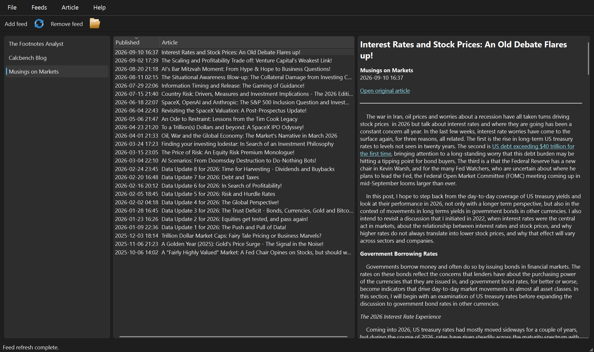
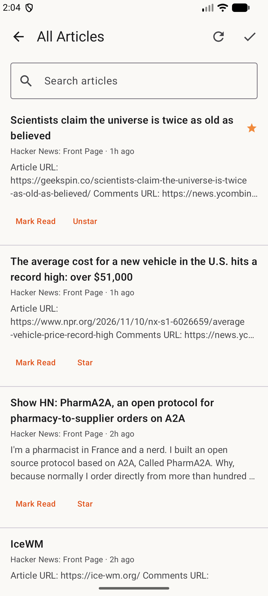

<!-- last_updated: 2026-11-22 -->
<!-- Authoring guidance: dev-docs/specs/README_SPEC.instructions.md -->
<!-- rumdl-disable MD033 MD041 -->

  

<h1 align="center">Plain RSS</h1>

  Follow RSS and Atom feeds and read articles in a focused interface on
  Android and iOS.

  
  
  
  
  

  <a href="#download">Download</a> ·
  <a href="docs/USER_MANUAL.md">User manual</a> ·
  <a href="docs/PRIVACY.md">Privacy</a>

<!-- rumdl-enable MD033 MD041 -->

---

## About

Plain RSS brings updates from the websites you choose into one reader, with no
account and no feed service in between. Subscribe to feeds, refresh their
articles, and open the original story when you want to read more. Your
subscriptions are stored on your own device. iOS and Android also save
downloaded articles there; Windows keeps them only until you close the app.
Windows provides a three-pane desktop reader; iOS and Android add a saved
article library with folders, read status, and stars.

<!-- Verified from: platform/windows/plain_rss/gui/views/root_window/window.py; platform/ios/plain RSS/ContentView.swift; platform/ios/plain RSS/Item.swift; platform/android/app/src/main/kotlin/com/plaintxtoffice/plainrss/viewmodel/ReaderViewModel.kt; platform/android/app/src/main/kotlin/com/plaintxtoffice/plainrss/storage/LibraryStore.kt -->

## Features

- **Windows, iOS, and Android:** subscribe to RSS and Atom feeds, refresh
  articles, and open original stories in your browser.
- **Windows:** browse subscriptions, article lists, and previews side by side;
  customize date displays and column sorting; export subscriptions as JSON.
- **iOS and Android:** add a feed from a website's address when you do not
  know the feed address; the app finds the feed the page advertises.
- **iOS and Android:** browse all, unread, or starred articles; search article
  titles and summaries; organize feeds into folders; import and export OPML
  subscriptions.
- **iOS and Android:** keep downloaded articles available offline, control
  article retention, and load remote reader images only when you choose.
- **iOS and Android:** pull down to refresh, and swipe an article to mark it
  read or star it.
- **iOS and Android:** send a bug report or feature request from inside the
  app. On Windows, use the [contact form](https://plaintxtoffice.com/contact/).

<!-- Verified from: platform/windows/plain_rss/gui/views/root_window/window.py; platform/windows/plain_rss/config/settings.py; platform/ios/plain RSS/ContentView.swift; platform/ios/plain RSS/ReaderSettings.swift; platform/ios/plain RSS/OPML.swift; platform/ios/plain RSS/FeedFetcher.swift; platform/ios/plain RSS/Feedback.swift; platform/android/app/src/main/kotlin/com/plaintxtoffice/plainrss/network/FeedFetcher.kt; platform/android/app/src/main/kotlin/com/plaintxtoffice/plainrss/ui/PlainRssScreen.kt; platform/android/app/src/main/kotlin/com/plaintxtoffice/plainrss/ui/Dialogs.kt; platform/android/app/src/main/kotlin/com/plaintxtoffice/plainrss/ui/Feedback.kt; platform/android/app/src/main/kotlin/com/plaintxtoffice/plainrss/domain/OpmlCodec.kt -->

## App Screenshot

### Windows

<!-- rumdl-disable MD033 -->

  

<!-- rumdl-enable MD033 -->

### Android

<!-- rumdl-disable MD033 -->

  

<!-- rumdl-enable MD033 -->

The iOS app uses its own navigation and controls; its screenshot will be added
when a capture is available.

## Download

| Platform | Download | Notes |
| --- | --- | --- |
| Android | [Google Play](https://play.google.com/store/apps/details?id=com.plaintxtoffice.plainrss) | Free on Google Play. Requires Android 8.0 or later. |
| iOS | [App Store](https://apps.apple.com/app/id6837553488) | Free on the App Store, version 1.0. Requires iOS 26.4 or later on iPhone or iPad. |

The Windows app has not been released yet.

<!-- Verified from: platform/android/app/build.gradle.kts [applicationId, minSdk]; platform/ios/plain RSS.xcodeproj/project.pbxproj [MARKETING_VERSION, IPHONEOS_DEPLOYMENT_TARGET] -->

## User Manual

See the [User Manual](docs/USER_MANUAL.md) for installation availability,
setup, everyday tasks, settings, and troubleshooting.

## Feedback

Send bug reports and feature requests to
[support@plaintxtoffice.com](mailto:support@plaintxtoffice.com), through the
[contact page](https://plaintxtoffice.com/contact/), or in
[GitHub Issues](https://github.com/PlainTxtOffice/plain-rss/issues). In the
Android and iOS apps, choose **More > Send Feedback** to prepare an email with
the app and device details filled in, or to open the contact page.

## License

Plain RSS is licensed under the [MIT License](LICENSE).
Copyright © 2026 Plain Text Office LLC.
