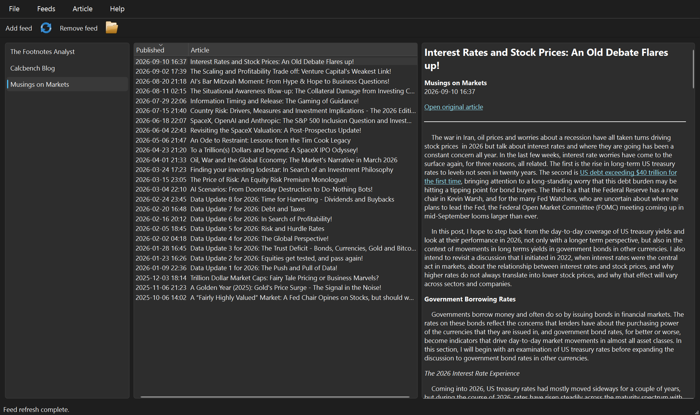
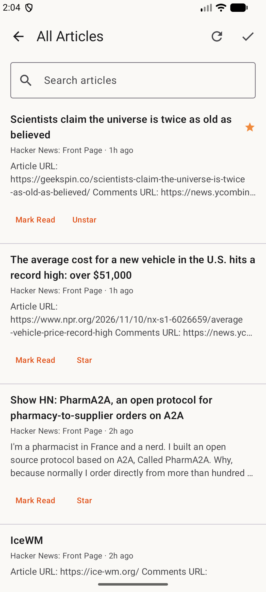

<!-- last_updated: 2026-11-13 -->
<!-- Authoring guidance: dev-docs/specs/README_SPEC.instructions.md -->
<!-- rumdl-disable MD033 MD041 -->

  

<h1 align="center">Plain RSS</h1>

  Follow RSS and Atom feeds and read articles in a focused interface on
  Windows, iOS, and Android.

  <a href="docs/USER_MANUAL.md">User manual</a> ·
  <a href="docs/PRIVACY.md">Privacy</a>

<!-- rumdl-enable MD033 MD041 -->

---

## About

Plain RSS brings updates from the websites you choose into one reader, with no
account and no feed service in between. Subscribe to feeds, refresh their
articles, and open the original story when you want to read more. Your
subscriptions and articles are stored on your own device. Windows provides a
three-pane desktop reader; iOS and Android add a saved article library with
folders, read status, and stars.

<!-- Verified from: platform/windows/plain_rss/gui/views/root_window/window.py; platform/ios/plain RSS/ContentView.swift; platform/ios/plain RSS/Item.swift; platform/android/app/src/main/kotlin/com/plaintxtoffice/plainrss/viewmodel/ReaderViewModel.kt; platform/android/app/src/main/kotlin/com/plaintxtoffice/plainrss/storage/LibraryStore.kt -->

## Features

- **Windows, iOS, and Android:** subscribe to RSS and Atom feeds, refresh
  articles, and open original stories in your browser.
- **Windows:** browse subscriptions, article lists, and previews side by side;
  customize date displays and column sorting; export subscriptions as JSON.
- **iOS and Android:** browse all, unread, or starred articles; search article
  titles and summaries; organize feeds into folders; import and export OPML
  subscriptions.
- **iOS and Android:** keep downloaded articles available offline, control
  article retention, and load remote reader images only when you choose.
- **iOS and Android:** pull down to refresh, and swipe an article to mark it
  read or star it.
- **Android:** send a bug report or feature request from inside the app.

<!-- Verified from: platform/windows/plain_rss/gui/views/root_window/window.py; platform/windows/plain_rss/config/settings.py; platform/ios/plain RSS/ContentView.swift; platform/ios/plain RSS/ReaderSettings.swift; platform/ios/plain RSS/OPML.swift; platform/android/app/src/main/kotlin/com/plaintxtoffice/plainrss/ui/PlainRssScreen.kt; platform/android/app/src/main/kotlin/com/plaintxtoffice/plainrss/ui/Dialogs.kt; platform/android/app/src/main/kotlin/com/plaintxtoffice/plainrss/ui/Feedback.kt; platform/android/app/src/main/kotlin/com/plaintxtoffice/plainrss/domain/OpmlCodec.kt -->

## App Screenshot

### Windows

<!-- rumdl-disable MD033 -->

  

<!-- rumdl-enable MD033 -->

### Android

<!-- rumdl-disable MD033 -->

  

<!-- rumdl-enable MD033 -->

The iOS app uses its own navigation and controls; its screenshot will be added
when a capture is available.

## User Manual

See the [User Manual](docs/USER_MANUAL.md) for installation availability,
setup, everyday tasks, settings, and troubleshooting.

## License

Plain RSS is proprietary software. Copyright © 2026 Tripp. All rights
reserved. The source is published for reference only; see [LICENSE](LICENSE)
for the terms.
